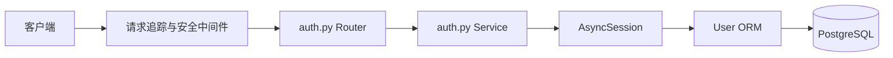
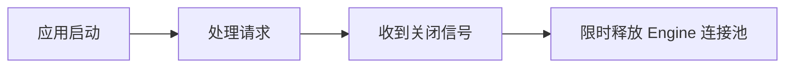

# 后端架构说明

## 登录请求链路



Router 通过 `session: DbSession` 声明数据库依赖。FastAPI 调用 `get_db_session()` 创建独立 AsyncSession，Router 再把 Session 传给 `auth_login()`。Service 不导入 `Depends`，也不自行创建或关闭 Session。

## Engine、连接池和 Session

- AsyncEngine 每个进程创建一个，负责管理连接池。
- `pool_size` 是常驻连接数，`max_overflow` 是繁忙时允许增加的临时连接数。
- Session 是单次请求的数据库工作单元，不能在并发请求间共享。
- `get_db_session()` 只管理 Session 生命周期，不自动 commit。
- 当前登录只有 SELECT，不需要 commit；未来写操作由 Service 显式 commit/rollback。

## Service 层目录结构

Service 层按**领域**分包，不再把所有 `*_services.py` 平铺在同一目录：

```text
app/services/
├── auth/          auth_services, user_services
├── lab/           lab_services, equipment_services
├── reservation/   reservation_services
├── knowledge/     knowledge_services, knowledge_ingestion_services,
│                  knowledge_retrieval_services, knowledge_storage_services,
│                  knowledge_worker_services, document_parser_services,
│                  bailian_document_services, bailian_embedding_services,
│                  bailian_rerank_services
└── ai/            ai_services, chat_services, ai_provider_services,
                   ai_usage_services, ai_tool_services, ai_action_services,
                   agent_graph_services, agent_tool_services,
                   chat_pipeline_services, stream_services,
                   providers/（base, minimax, bailian）
```

包之间的依赖方向：

- `ai` → `knowledge`：`ai_services` 需要调用知识检索；
- `knowledge` → `ai`：`knowledge_ingestion` 需要读取模型配置、调用供应商适配器；
- `ai` → `reservation`：待确认预约动作最终创建真实预约。

即 `ai` 与 `knowledge` 存在**双向依赖**。这在模块级不成环，但必须遵守一条规则：
**所有 `__init__.py` 保持为空，禁止 re-export**。否则导入任一子模块都会触发整条依赖链，变成真正的循环导入。

新增功能按领域放进对应包；详细说明见 `app/services/README.md`。

## AI 对话链路

```text
POST /api/ai/chat（或 /chat/stream）
  └─ chat_pipeline_services.prepare_text_chat_context()
       ├─ intent_services.classify()                       ← intent 能力，可选
       ├─ knowledge_retrieval_services.search_knowledge()   ← need_knowledge 为真时执行
       └─ 按 need_tools 裁剪 AGENT_TOOLS
  └─ ai_services.chat()
       └─ LangGraph: agent → tools →（agent | finalize）
            └─ agent_tool_services.execute_agent_tool()
                 └─ prepare_reservation 之前
                      └─ decision_services.verify_reservation_params()  ← decision 能力，可选
```

`intent` 与 `decision` 都是**可选增强**：未配置、调用失败或输出无法解析时，
一律退回「检索照常、工具全开、草稿放行」，也就是加入这两个能力之前的行为。
配置方法与降级规则见 [AI 意图识别与决策能力](AI_INTENT_DECISION.md)。

## AI 配置控制面与供应商切换

管理员前端是配置入口，但不是配置规则的最终裁决者：

```text
AIConfig.vue
  └─ PUT /api/ai/admin/configs/{capability}
       └─ ai_provider_services
            ├─ 校验 capability/provider 兼容矩阵
            ├─ 加密保存 API Key
            └─ 写入 AIProviderConfig

一次业务调用
  └─ get_capability_config() 每次读取当前启用配置
       └─ providers.get_provider(config.provider)
            ├─ MiniMaxProvider
            └─ BailianProvider
```

- 前端通过后端返回的 `allowed_providers` 生成下拉选项，不再复制兼容规则；
- OCR、Embedding、Rerank 当前只允许百炼，绕过前端调用接口也会被拒绝；
- 首次配置或切换供应商时必须提交新供应商的 API Key，同供应商修改模型时才允许留空保留旧 Key；
- 配置不做进程内缓存，保存后下一次请求立即使用新供应商，无需重启；
- `MiniMaxProvider` 与 `BailianProvider` 都实现 Responses 流式调用，Router 和前端无需按供应商分支；
- `stream_services` 只负责 SSE 生命周期，`ai_services` 负责一轮聊天与落库，避免传输协议混入模型业务。

## 中间件顺序

```text
RequestIdMiddleware
  └─ UnexpectedErrorMiddleware
      └─ BodySizeLimitMiddleware
          └─ Router
```

- request_id 标识整次请求，并写入 `X-Request-ID`。
- error_id 标识一次未知异常，客户端可用它查询服务端日志。
- 未知异常完整 traceback 同时写入终端和本次进程的独立日志文件。
- 请求体超过配置上限时直接返回 413。

## lifespan



lifespan 不运行 DDL、`create_all()` 或 Alembic。所有数据库结构变化都通过显式迁移命令完成。

## Alembic 防误删

`models/__init__.py` 显式导入 User。`alembic_guard.py` 在 autogenerate 时拒绝空 metadata，防止忘记导入 Model 后生成删除全部表的迁移。
