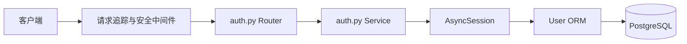
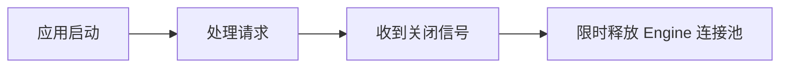

# 后端架构说明

## 登录请求链路



Router 通过 `session: DbSession` 声明数据库依赖。FastAPI 调用 `get_db_session()` 创建独立 AsyncSession，Router 再把 Session 传给 `auth_login()`。Service 不导入 `Depends`，也不自行创建或关闭 Session。

## Engine、连接池和 Session

- AsyncEngine 每个进程创建一个，负责管理连接池。
- `pool_size` 是常驻连接数，`max_overflow` 是繁忙时允许增加的临时连接数。
- Session 是单次请求的数据库工作单元，不能在并发请求间共享。
- `get_db_session()` 只管理 Session 生命周期，不自动 commit。
- 当前登录只有 SELECT，不需要 commit；未来写操作由 Service 显式 commit/rollback。

## 中间件顺序

```text
RequestIdMiddleware
  └─ UnexpectedErrorMiddleware
      └─ BodySizeLimitMiddleware
          └─ Router
```

- request_id 标识整次请求，并写入 `X-Request-ID`。
- error_id 标识一次未知异常，客户端可用它查询服务端日志。
- 未知异常完整 traceback 同时写入终端和本次进程的独立日志文件。
- 请求体超过配置上限时直接返回 413。

## lifespan



lifespan 不运行 DDL、`create_all()` 或 Alembic。所有数据库结构变化都通过显式迁移命令完成。

## Alembic 防误删

`models/__init__.py` 显式导入 User。`alembic_guard.py` 在 autogenerate 时拒绝空 metadata，防止忘记导入 Model 后生成删除全部表的迁移。
