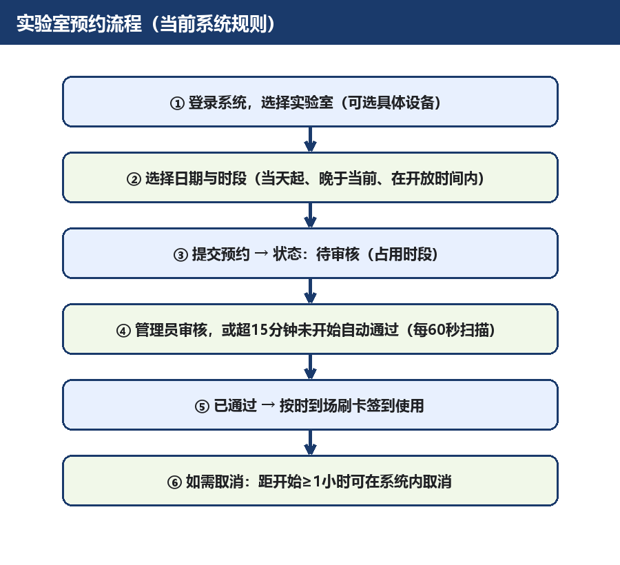

# 实验室预约操作指南

本指南说明 AI智能实验室预约系统 当前的预约规则与操作步骤。规则与后端服务当前实现一致。

## 一、预约前须知

- 必须先登录系统才能预约；
- 预约日期不能早于中国北京时间（UTC+8）当天；
- 开始时间必须早于结束时间，且必须晚于当前时间；
- 预约时段必须位于目标实验室开放时间内；
- **关闭状态的实验室不能预约**（当前：综合开放实验室）；
- 预约设备时：设备必须属于所选实验室，维修中的设备不能预约。

## 二、状态说明

| 状态码 | 含义 | 是否占用时段 |
| --- | --- | --- |
| 0 | 待审核 | 占用 |
| 1 | 已通过 | 占用 |
| 2 | 已拒绝 | 不占用 |
| 3 | 已取消 | 不占用 |

## 三、审核与自动通过

- 管理员只能审核"待审核"状态的预约；
- 待审核超过 **15 分钟** 且预约尚未开始时自动通过；后台每 60 秒扫描一次，因此自动通过可能发生在超过 15 分钟后的下一次扫描；
- 已到预约开始时间仍为"待审核"的记录自动取消。

## 四、冲突规则

- 只预约实验室时，冲突检查对象是同一实验室的实验室预约；
- 预约具体设备时，冲突检查对象是同一设备对应的预约；
- 待审核与已通过的记录都会占用时段。

## 五、取消规则

- 可取消本人"待审核"或"已通过"的预约；
- 已拒绝或已取消的记录不能再次取消；
- **已经开始的预约不能取消**；
- 距离开始不足 1 小时不能取消；恰好剩余 1 小时允许取消。

## 六、常见问题

**Q：为什么我约不了综合开放实验室？**
A：该实验室因设备维护整室关闭，恢复前系统会拒绝预约。

**Q：为什么 3D 打印机选不了？**
A：该设备维修中；且其所属实验室也处于关闭状态。

**Q：系统还有哪些限制？**
A：当前系统**没有**"提前一天预约""每人每天一次""单次最长两小时""周末关闭""收费""信用分"等规则；如通知中出现此类说法，请以本指南为准并向管理员核实。
