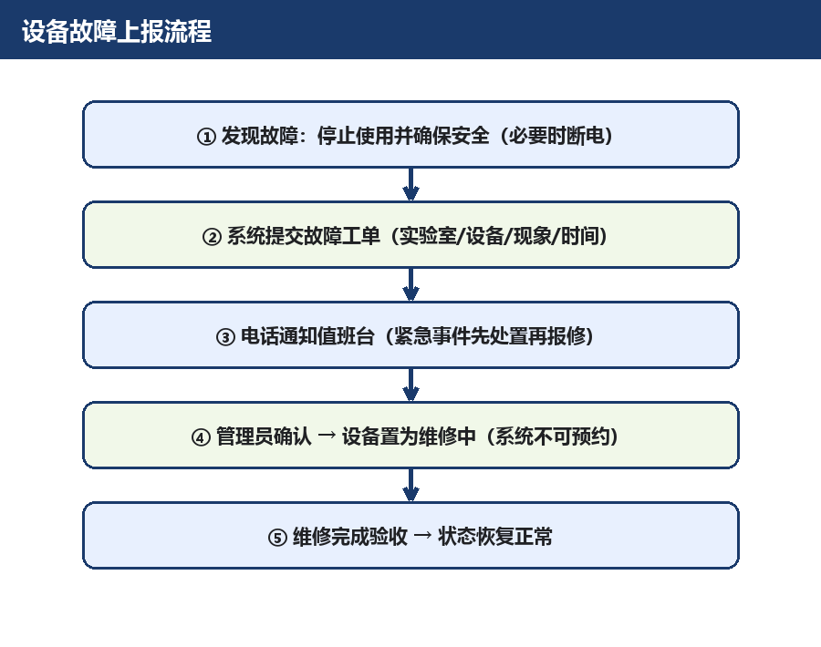

# 设备故障上报流程指南

## 一、发现故障后立即做什么

1. **停止使用**故障设备，必要时先断电（电气异常、冒烟、异响）；
2. 在设备旁放置"停用"提示（或告知值班台）；
3. 不要自行拆修。

## 二、上报渠道

1. 登录 AI智能实验室预约系统，在"故障上报"入口提交工单，写明：实验室、设备名称、故障现象、发生时间、已尝试的排查；
2. 同步电话通知值班台（各室短号见各室手册）；
3. 紧急情况（触电、火情、漏水）先按应急流程处置，再补报工单。

## 三、后续流程

- 管理员确认后，设备在系统中置为"维修中"，自动不可预约；
- 维修完成经验收后恢复"正常"状态；
- 维修进展可在《设备维修记录》中查询。

## 四、当前维修中设备

- 3D 打印机（综合开放实验室）：2026-10-12 起返厂维修；
- 注意：其所属实验室同步整室关闭。

## 五、参考制度

《设备故障报修与停用制度》《实验室安全管理总则》
